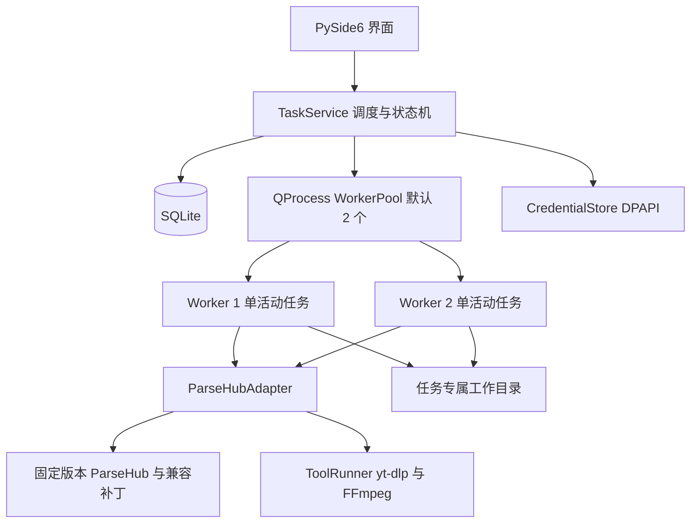
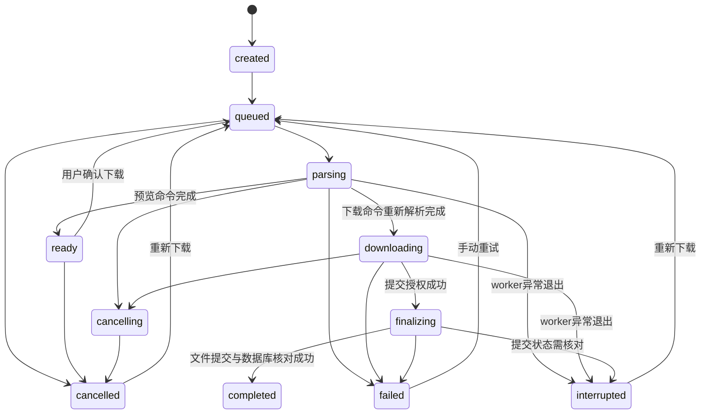

# Windows 媒体下载器设计方案

状态：实施基线 v2，2026-11-03。配套：[开发计划](./development-plan.md)、[内核更新设计](./engine-updates.md)。

## 产品与界面

主流程：粘贴分享文案 → 解析 → 预览 → 加入下载 → 查看文件。

桌面采用 PySide6 Widgets。首版为简洁的原生桌面工具，默认浅色、支持深色；使用系统字体，固定一套间距、颜色和状态词。任务不只靠颜色区分状态。

主窗口建议默认 1120×760，最小 900×600，逻辑尺寸随系统 DPI 缩放。

```text
┌───────────────────────────────────────────────────────────┐
│ Media Downloader                          [新增下载]       │
├────────────┬──────────────────────────────────────────────┤
│ 新建下载   │ 粘贴链接或分享文案                           │
│ 下载队列 2 │ ┌──────────────────────────────────────────┐ │
│ 历史记录   │ │ 输入区                                   │ │
│            │ └──────────────────────────────────────────┘ │
│ 设置       │ [解析链接]   保存到 D:\Media  [选择目录]      │
│            │                                              │
│            │ [封面] 标题 / 平台 / 媒体类型                 │
│            │        图集 8 张 / 当前可用格式                │
│            │        [加入下载] [查看来源]                   │
├────────────┴──────────────────────────────────────────────┤
│ 2 项处理中 · 3 项排队                                     │
└───────────────────────────────────────────────────────────┘
```

页面行为：

| 页面 | 内容 | 主要动作 |
|---|---|---|
| 新建下载 | 多行输入、解析结果、封面、标题、平台、媒体数、格式 | 解析、选目录、加入下载、清除结果 |
| 下载队列 | 标题、状态、阶段进度、真实速度/ETA、目录 | 取消、重试、详情 |
| 历史记录 | 搜索、完成/失败筛选、时间、输出路径 | 打开文件/目录、重新下载、移除记录 |
| 设置 | 默认目录、并发、平台代理、Cookie、客户端/内核版本、诊断 | 保存、测试代理、更新/删除 Cookie、检查内核更新、安装/回滚、导出诊断 |

解析结果仅渲染纯文本和受限尺寸封面；首版不直接执行平台 HTML/Markdown。图集可预览缩略图，但整组下载。未知大小显示“大小未知”；合并阶段显示“正在处理文件”，不假造速度。

未提供格式列表的平台隐藏画质下拉框。预览后重新解析若原选择消失，返回“所选格式已不可用”，由用户重新确认，不静默替换。

错误面向用户显示类别、简短原因和动作，例如“Cookie 已失效 → 更新 Cookie”；技术详情放在可展开区域。复制诊断信息时自动脱敏。

关闭窗口时若存在下载，提供“返回应用”和“取消任务并退出”；不默认隐藏到托盘。移除历史只删记录；首版不提供从历史递归删除文件的功能。

## 进程与模块边界



应用进程负责 UI、调度、数据库和 worker 生命周期；worker 负责网络解析、媒体处理与下载。每个 worker 同时只接一条执行命令，便于强制取消时隔离影响。

数据库连接由 TaskService 所在线程独占。首版小型状态写入可在 UI 事件线程完成，禁做长查询和批量文件操作；若性能测量不达标，将仓储移到独立线程，仍保持单写入者。

worker 持有长期 asyncio 循环。标准输入使用专门读取线程，命令经线程安全队列送入循环；标准输出只写协议 JSON，日志走 stderr。验证所选事件循环同时支持 curl-cffi 和 asyncio 子进程，不用全局替换循环来规避单一库问题。

启动 2 个 worker，每个允许一项活动任务。预览解析与下载共用槽位；空闲 worker 崩溃时自动补充，活动任务先标为中断，不静默重试。所有 worker 和其工具后代纳入 Windows Job Object，防止主程序异常退出留下后代进程。

目录建议：

```text
src/media_downloader/
  app.py                  # 启动、单实例、依赖装配
  ui/                     # 窗口、页面、视图模型、组件、主题
  application/            # TaskService、WorkerPool、命令与事件
  domain/                 # Task、状态、能力、错误、DTO
  infrastructure/         # SQLite、DPAPI、文件、工具与日志
  adapters/parsehub/       # 上游对象到应用模型的适配
  worker/                 # 独立入口、执行器、IPC
vendor/parsehub/           # 完整上游基线和必要兼容补丁
tools/                    # 构建时放入固定版外部工具
tests/                    # 单元、集成、冻结构建检查
packaging/                # PyInstaller 与安装程序配置
docs/                     # 支持矩阵、迁移与发行记录
```

当前 `upstream-ParseHub` 仅是审查快照，正式开发重新获取完整上游与锁文件，确认来源后再放入 vendor。

## 核心接口和数据契约

UI 只依赖应用模型；不持有 ParseResult、私有 yt-dlp info_json 或 Cookie 原文。

```python
class ParserAdapter:
    async def inspect(self, source, context) -> Preview: ...
    async def execute(self, source, selection, context, progress) -> ExecutionResult: ...

class CredentialStore:
    def save(self, platform, cookie) -> str: ...  # 返回 credential_ref
    def read(self, credential_ref) -> str: ...
    def delete(self, credential_ref) -> None: ...
```

Preview 包含 source_url、canonical_url、platform、title、media_type、media_count、thumbnail、可空 duration_seconds、formats 和 capabilities。媒体 CDN URL 只留执行过程，不作为持久执行计划。

PlatformCapabilities 包含：视频/图集/LivePhoto 支持、是否支持格式选择、是否可用 Cookie、当前可用/实验/不可用状态。UI 根据该模型显示控件，不能只按平台名硬编码。

执行时总是重新解析来源链接，使签名地址和当前凭据生效；预览仅用于确认内容。重新解析后校验平台资源 ID、媒体类别和选择，资源发生变化时要求重新预览。

每条 IPC 消息 UTF-8 JSON 一行，协议版本从 1 开始，单条最大 1 MiB；禁止 pickle。stdout 不允许混入第三方普通日志。大图、完整页面、info_json 不进入 IPC。

命令类型：hello、inspect、execute、cancel、authorize_commit、shutdown。所有活动命令包含 command_id、task_id、attempt_id；执行参数包含输出工作目录、selection、连接预算、代理配置和临时凭据引用。

事件类型：ready、started、preview_ready、progress、commit_requested、completed、failed、cancelled、heartbeat。

```json
{
  "protocol": 1,
  "type": "progress",
  "task_id": "task-uuid",
  "attempt_id": "attempt-uuid",
  "seq": 18,
  "payload": {
    "phase": "downloading",
    "completed_bytes": 1048576,
    "total_bytes": null,
    "completed_items": 1,
    "total_items": 8,
    "percent": null,
    "speed_bps": 524288,
    "eta_seconds": null
  }
}
```

上例为协议示意，不代表实测数据。每个 attempt 的 seq 单调递增；旧 attempt 或重复 seq 丢弃。进度最多每秒 5 次，状态变更立即发送；拥塞时合并进度，不丢终态。缺少字节数据时速度/ETA 留空。

Cookie 不作为命令行参数、环境变量或日志字段。TaskService 解密后通过受控 stdin 管道传入 worker，尽快释放引用；第三方工具必须使用临时 Cookie 文件时，用当前用户访问控制并在 finally 中清理，启动时清扫应用拥有的过期临时文件。

## 任务状态与取消



queued 携带 action=inspect/download，控制解析后去 ready 还是 downloading。每次真正执行生成新 attempt_id；已经完成的任务“重新下载”生成新 task_id，保留历史。失败重试沿用 task_id 并新建 attempt。

取消流程：TaskService 先持久化 cancelling，再通知 worker；协作取消超时则终止该 worker 的 Job Object，确认进程退出后标记 cancelled 并补充 worker。用户未发起取消的意外退出标记 interrupted。

完成与取消竞争采用提交握手：worker 下载校验完成后发 commit_requested；TaskService 只有在当前 attempt 仍为 downloading 时，事务切换到 finalizing 并返回 commit_token。若已 cancelling 则拒绝提交。finalizing 禁止用户取消，并在 UI 显示短暂“正在保存”；收到完成事件后核对 manifest 与最终目录，再写 completed。

最终目录已提交但 completed 未落库时，启动恢复根据 manifest 补记完成。若仍只有工作目录，标记 interrupted，不能仅因存在若干文件就认为成功。提交中禁止盲目自动重试。

首版没有 paused 状态。中断任务显示“重新下载”，不承诺保留字节进度。

## 数据与文件

应用数据放在 `%LOCALAPPDATA%\MediaDownloader`，不写安装目录。使用 SQLite WAL 和外键；迁移带 schema_version，升级前备份，迁移失败保留旧数据并展示恢复说明。

| 表 | 主要字段 |
|---|---|
| tasks | id、source_text/URL、canonical_url、platform、resource_id、title、media_type、state、action、selection_json、output_root、final_dir、revision、created_at、updated_at |
| attempts | id、task_id、started_at、finished_at、state、worker_id、engine_version、upstream_sha、error_code、sanitized_message、work_dir、commit_token、配置版本 |
| outputs | id、attempt_id、relative_path、media_type、size_bytes、可选 checksum |
| platform_settings | platform、parse_proxy_ref、download_proxy_ref、credential_ref、updated_at |
| settings | key、value_json、version |
| schema_version | version、applied_at |

任务和 attempt 状态改变在同一事务提交。仅持久化必要阶段信息，进度最多每 2 秒合并写入一次，不记录每个网络 chunk。

包含令牌的原始分享 URL 用 DPAPI 加密字段保存，以便重新解析；canonical_url 可为去掉无关跟踪参数的显示链接。日志和诊断不导出原始令牌。代理若带密码，其完整配置同样加密，普通设置仅存引用。

输出布局：

```text
用户选择的下载根目录/
  .media-downloader-work/<task_id>/<attempt_id>/
    payload/                 # 上游生成的媒体子目录
    manifest.json            # 应用拥有、无凭据的提交记录
  标题_短任务ID/              # 最终完成目录
```

工作目录放在目标根目录下，确保正常情况下同卷提交。上游下载目录完全位于独占 payload 内，不允许上游清理逻辑触及其他任务或用户目录。文件名统一过滤非法字符、设备保留名、尾随点/空格并限制长度；扩展名只能来自经过验证的格式字段。

最终目录使用“清洗标题_短任务ID”，遇到冲突重新生成唯一后缀；用不覆盖目标的同卷目录重命名提交。完整 manifest 在授权前写入，包含 task_id、attempt_id、最终相对路径、文件清单和大小；finalizing 时不把已有用户目录当覆盖目标。

成功条件：所有承诺媒体存在、大小校验通过、工具返回成功、必要后处理结束。图集部分失败整体标记失败，但显示已完成项数；保留工作目录到用户重试/清理，首版重试整组。取消目录清理失败时登记清理记录，后续重试，不影响其他任务。

重启恢复逐项核对 finalizing/活动任务、manifest、最终目录；仅删除能够用任务归属验证的工作目录。卸载默认保留下载文件和用户数据。

## 凭据、网络和错误策略

Cookie 首版手动输入，DPAPI 当前用户保护；设置页只显示“已保存/未设置/上次验证失效”。读取失败要求重新输入，不尝试恢复明文。

解析和下载代理可分别设置；默认直连，使用系统代理需显式启用。每个 attempt 快照代理配置，运行中修改设置不影响正在下载的任务；Cookie 更新对下一次执行生效。

URL 接受 http/https，平台入口精确 hostname 校验。缩略图和媒体下载也校验协议、重定向与大小预算，默认拒绝 loopback/link-local/私网目标，并处理 DNS 重绑定与逐跳重定向；不因入口是支持平台就信任任意返回地址。

| 错误码 | 用户动作 | 自动处理 |
|---|---|---|
| UNSUPPORTED_URL | 检查链接/查看平台清单 | 不重试 |
| AUTH_REQUIRED / AUTH_EXPIRED | 设置/更新 Cookie | 不自动重试 |
| CONTENT_UNAVAILABLE | 查看来源 | 不重试 |
| RATE_LIMITED | 稍后再试 | 当前 attempt 停止，提示冷却 |
| NETWORK_TIMEOUT / NETWORK_ERROR | 检查网络/代理 | 底层有限重试，不叠加应用整任务重试 |
| FORMAT_UNAVAILABLE | 重新预览 | 不静默换格式 |
| DISK_FULL / PERMISSION_DENIED | 清理空间/更换目录 | 不网络重试 |
| TOOL_MISSING / TOOL_FAILED | 查看工具诊断 | 不自行下载安装 |
| WORKER_CRASHED | 重新下载 | 标记中断并补充 worker |

所有阶段有超时预算，细分连接、读取、解析总时限、取消宽限与提交核对。M0 测量后固定默认值；下载采用活动/读取超时，不用过短总时限截断正常大文件。

日志按大小轮转，默认 5 份 × 5 MiB。日志包含版本、任务/attempt ID、阶段、脱敏 host、错误码；不写 Cookie、完整签名 URL、代理密码、完整网页响应。导出诊断须用户主动操作，可预览导出内容，不自动上传。

## 工具、打包和升级

ToolRunner 显式解析当前内核包内的 yt-dlp/FFmpeg 路径，用 argv 列表启动，不走 shell、不拼接用户命令。开发模式与冻结模式各有确定入口，应用启动时显示实际工具版本。

UI 与 worker 分开冻结为 onedir 产物；安装包携带可用的基线内核，新内核放在用户数据目录的版本化路径，支持独立安装。动态解析器、原生 DLL 和必要资源显式收集。首选 onedir 是为定位依赖问题，安装包体积与启动时间在 M0 测量后再优化。

安装与构建清单固定 ParseHub SHA、补丁版本、Python、全部依赖和工具的来源/版本/哈希。内核连同它依赖的工具按签名版本包整体升级，不在客户端运行 pip 动态安装。主程序和数据库迁移仍由客户端完整版本更新负责；内核无权迁移应用数据库。更新与回滚规则详见 [内核更新设计](./engine-updates.md)。

## 实施验收

架构验收重点为：UI 不执行耗时 I/O、一个 worker 故障不影响另一任务、IPC 幂等、取消不误标完成、同名输出互不覆盖、恢复不重复提交、凭据不进入日志、冻结包在干净机独立运行。

先建立内核回归与任务状态集成测试，再进行界面流程验证和真实平台回归。状态、并发、文件归属、恢复和打包都要有针对性证据；不以“测试数量”代替行为验证。

所有性能、兼容性和平台支持均在 M0/M4/M5 的实测报告中标记为已验证后，才用于对外说明；阶段定义以统一开发计划为准。
